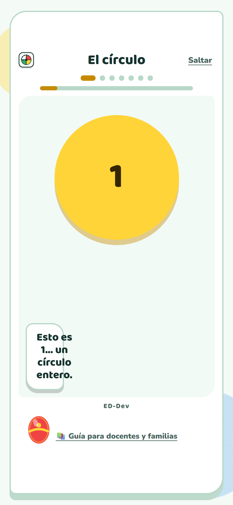
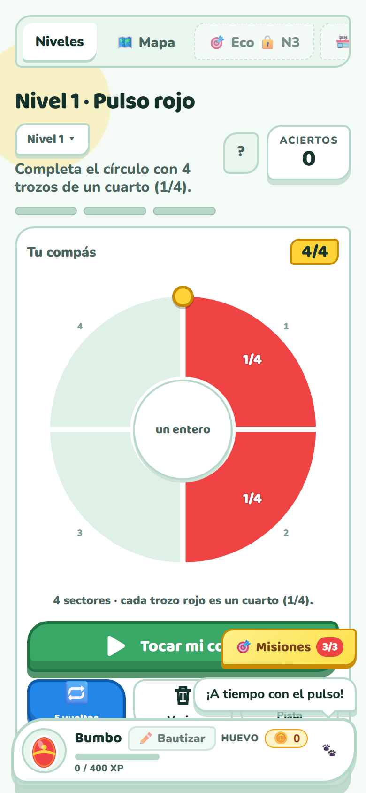
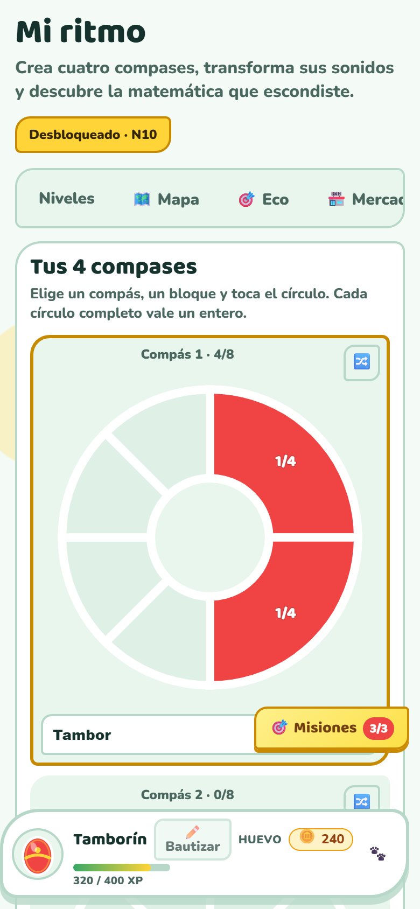
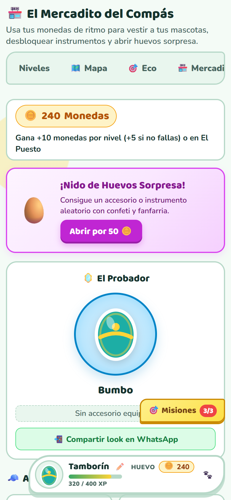

<p align="center"></p>

<h1 align="center">🥁 ED Compás Ritmico</h1>

<p align="center">
  <a href="https://edcompasritmico.vercel.app"><strong>▶ Probar la app en vivo</strong></a> ·
  <a href="https://github.com/ericksondaviddev-source/edcompasritmico/blob/main/LICENSE">Licencia MIT</a>
</p>

**Estudio musical y academia matemática infantil** — los niños aprenden fracciones
construyendo compases rítmicos: cada bloque musical es una fracción (`1/4`, `1/8`,
`1/2`, `3/8`, `6/8`…) y juntos llenan el círculo del compás (¡un entero!).

Creado por **ED-Dev** · App 100% estática, sin dependencias, sin backend.

## 📸 Capturas

| Intro guiada | Juego de fracciones |
|:---:|:---:|
|  |  |

| Creador de compases | Mercadito |
|:---:|:---:|
|  |  |

## ✨ Qué incluye

- 🎵 **18 niveles** progresivos: del pulso básico a la polirritmia, con rachas de aciertos y saltos de nivel
- ➗ **Academia matemática**: sumas, restas, multiplicaciones y divisiones *sonoras* (niveles 11–18)
- 🥁 **Figuras rítmicas**: cuartos, octavos, medios, redondas, silencios, **puntillos (3/8)** con síncopa y **piques dobles (2/16)** "ta-ka" · con lección interactiva de picos nuevos
- 🤫 **Pista de silencios**: tic suave durante las pausas para que el pulso se sienta a través del vacío (con toggle; los retos de oído quedan intactos)
- 🐣 **Mascotas con evolución**: Bumbo, Clave y Güira crecen con XP, se bautizan, llevan accesorios, **tintes de color** y una **firma sonora** que puede ser de 1 hasta 4 compases
- ✏️ **Creador de ritmos**: 4 compases, polifonía por nota (cada nota con su instrumento), **Modo Capas** para oír compases simultáneos, y exportación MP3/WAV
- 📚 **Biblioteca de compases** guardados con asignación directa a la mascota, y **modo canción** secuencial
- 🎯 **Mini-juegos**: Simon, Dúo (batalla de mascotas), Mapa, Mercadito y El Puesto
- 🎬 **Intro guiada** con mini-curso de fracciones + tour de la app (solo primera visita, con botón «¿Cómo se juega?»)
- 🎼 **Anuncios de desbloqueo** de nuevos mundos (Mi ritmo se anuncia con fanfarria al nivel 3)
- 📱 **Mobile-first**: diseño responsivo con `clamp()`, safe-areas y navegación táctil

## 🗂️ Arquitectura modular

```
index.html   → markup semántico (estructura pura)
styles.css   → estilos (mobile-first, variables CSS, modo oscuro)
logic.js     → lógica pura del juego (sin DOM) — exportada como COMPAS
data.js      → re-export de datos: niveles, retos, problemas, mascotas
main.js      → UI e interacciones (DOM, audio, eventos)
```

`logic.js` es pura y testeable: no toca el DOM, solo calcula.

## 🚀 Desarrollo local

Los módulos ES requieren servirse por HTTP (no funcionan con `file://`):

```bash
node server.cjs
# → http://localhost:8123
```

## 🧪 Verificado

- Sintaxis de los 3 módulos ES (Node)
- Suite headless en Chrome real (Playwright): intro, onboarding de mascota,
  progresión de niveles 1→3 con rachas, firma multi-compás, Modo Capas,
  puntillos, pista de silencios, tintes del mercadito, scroll móvil
  (360px y 390px) y cero errores de consola

## 📦 Despliegue

Desplegada en [Vercel](https://edcompasritmico.vercel.app) como sitio estático
(og:image incluida para compartir en redes/mensajería).

## 🗺️ Futuras ideas (si el feedback lo pide)

- Figuras de 1/16 solo en el Creador (con migración de datos guardados)

## 📄 Licencia

[MIT](LICENSE) — © 2025 ED-Dev
